# CertiChain: Certificate Verification DApp

Blockchain Technology (CSE4444), Assignment 2
Kashyapa Datta Dhondu, Reg. No. 230905392

Built with Solidity 0.8.19, Remix IDE, Ganache, MetaMask, Ethers.js and plain HTML/CSS/JavaScript.

## Problem

Fake degree certificates are easy to make, and verifying one normally means contacting the university. CertiChain stores certificate records on the blockchain so anyone can check them directly.

- The university (contract owner) adds or removes issuers.
- Issuers issue certificates (ID, student name, registration number, course, grade) and can revoke a certificate with a reason.
- Anyone can verify a certificate ID. This is a read-only call, so it needs no gas.

## Repository layout

```
contracts/CertificateRegistry.sol    smart contract
contracts/helpers/Outsider.sol       helper used by the unit tests
frontend/                            index.html, style.css, app.js, config.js
tests/CertificateRegistry_test.sol   Remix unit tests
tests/TEST_RESULTS.md                test cases and results
deployment/deployment-details.md     network, address, transactions
screenshots/                         evidence
```

## Smart contract

- **State:** `owner`, `institutionName`, `totalIssued`, `totalRevoked`, `isIssuer` mapping, certificates stored in a mapping keyed by `keccak256(certId)`.
- **Constructor:** takes the institution name, sets the deployer as owner and first issuer.
- **Owner functions:** `addIssuer`, `removeIssuer`, `transferOwnership`.
- **Issuer functions:** `issueCertificate`, `revokeCertificate`.
- **Read functions:** `verifyCertificate`, `getCertificate`, `getCertificateByIndex`, `getCertificateCount`.
- **Events:** `CertificateIssued`, `CertificateRevoked`, `IssuerAdded`, `IssuerRemoved`, `OwnershipTransferred`.

Validation (`require`) and the revert messages:

| Check | Message |
|---|---|
| Caller is an issuer | `Not an authorized issuer` |
| Caller is the owner | `Only owner can perform this action` |
| Fields are not empty | `<Field> cannot be empty` |
| Fields are at most 100 bytes | `<Field> too long` |
| Certificate ID is unique | `Certificate ID already exists` |
| Certificate exists before revoking | `Certificate does not exist` |
| Not already revoked | `Certificate already revoked` |
| Issuer address is not zero | `Invalid address` |
| Not already an issuer | `Already an issuer` |
| Owner cannot be removed as issuer | `Cannot remove owner as issuer` |

## How to run

1. **Ganache:** start a Quickstart workspace (RPC `http://127.0.0.1:7545`).
2. **MetaMask:** add a custom network with RPC `http://127.0.0.1:7545`, chain ID `1337`, symbol `ETH`. Import two Ganache accounts (account 0 as owner, account 1 for the unauthorised tests).
3. **Remix:** open `contracts/CertificateRegistry.sol`, compile with 0.8.19 (EVM version paris).
4. **Deploy:** in Deploy & Run, choose *Custom - External Http Provider*, enter `http://127.0.0.1:7545`, give the constructor `"Manipal Institute of Technology"` and deploy.
5. **Frontend:**
   ```bash
   cd frontend
   python3 -m http.server 8000
   ```
   Open `http://localhost:8000`.
6. **Connect:** click *Connect MetaMask* (the badge should show `Chain 1337 · Ganache` and your role), paste the contract address and click *Load contract*.
7. Use the forms to issue, verify and revoke certificates, and to add or remove issuers. Switch MetaMask to account 1 to try the unauthorised actions.

The "Testing mode" checkbox sends a transaction even if it would revert, so the failed transaction gets mined and shows up in Ganache and MetaMask.

## Deployment

| | |
|---|---|
| Network | Ganache (local), RPC `http://127.0.0.1:7545`, chain ID 1337 |
| Contract address | `0xF09604F25Ef088d3E69BA4f13Ac0B9CF98d7944C` |
| Deployer / owner | `0x554C91ddd2f17b634eE73F8FA37d42b37f1529D5` |
| Deployment tx | `0x3ae7fbadade5ffbfe9e052aa42a1af3f19159e730abad0f6db80501db49dc09a` |

More in [deployment/deployment-details.md](deployment/deployment-details.md).

## Tests

Unit tests: `tests/CertificateRegistry_test.sol` run in the Remix Solidity Unit Testing plugin. All 16 pass. They cover valid, invalid and unauthorised cases, including empty fields, duplicate IDs, revoking unknown or already revoked certificates, the zero address, and calls from non-owners and removed issuers.

Manual tests through the UI:

| # | Type | Account | Input | Expected | Observed |
|---|---|---|---|---|---|
| V1 | Valid | Owner | Issue `DIT-2026-CSE-001`, Kashyapa Datta Dhondu, 230905392, B.Tech CSE, 8.4 | Success | Success in block 2, gas 288935 (tx `0x5e5bb9ab402078eb34eec9e0bb3195cf9587afa4865b2653a5dc7ac15effddb8`) |
| V2 | Valid | Anyone | Verify `DIT-2026-CSE-001` | Authentic & valid | Authentic & valid, details shown |
| I1 | Invalid | Owner | Issue the same ID again | `Certificate ID already exists` | Transaction failed |
| I2 | Invalid | Anyone | Verify `DIT-2026-CSE-001` before it was issued | Not found | Not found |
| U1 | Unauthorised | Account 1 (not an issuer) | Issue a certificate | `Not an authorized issuer` | Blocked with `Not an authorized issuer` |

## Screenshots

| | |
|---|---|
| Compilation | 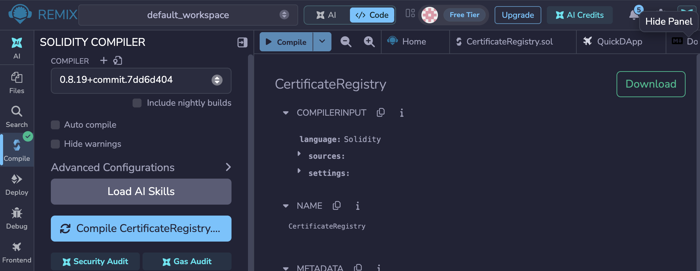 |
| Deployment | 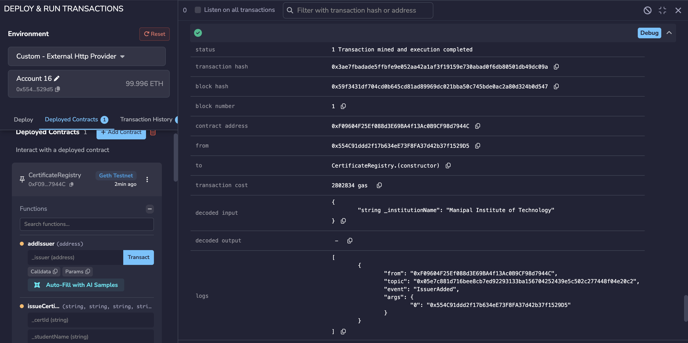 |
| Deployment log in Remix | 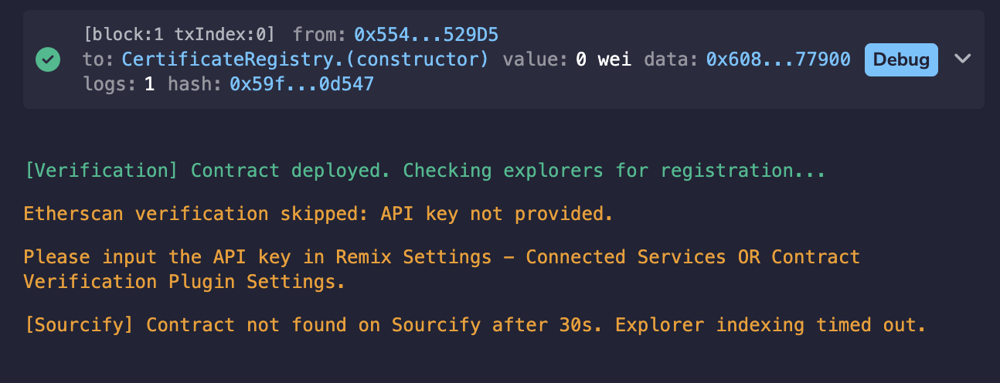 |
| Deployment in Ganache | 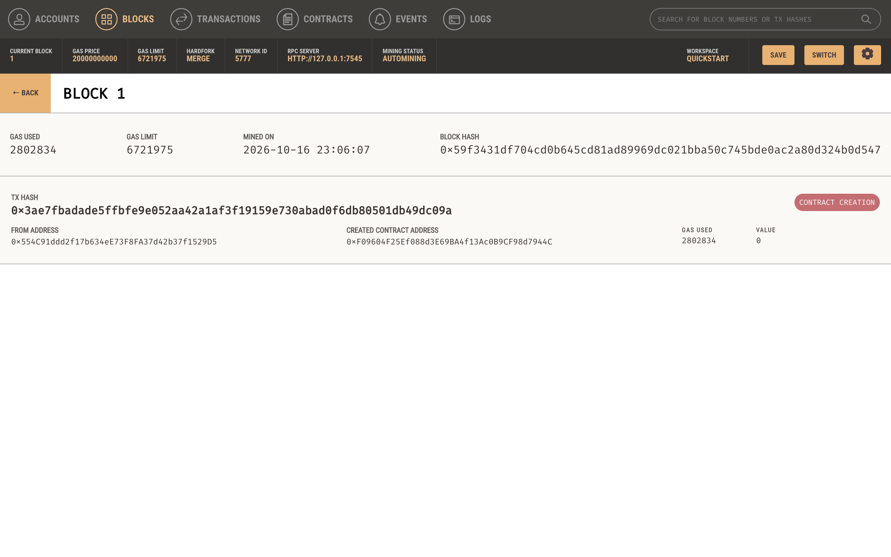 |
| Ganache blocks | 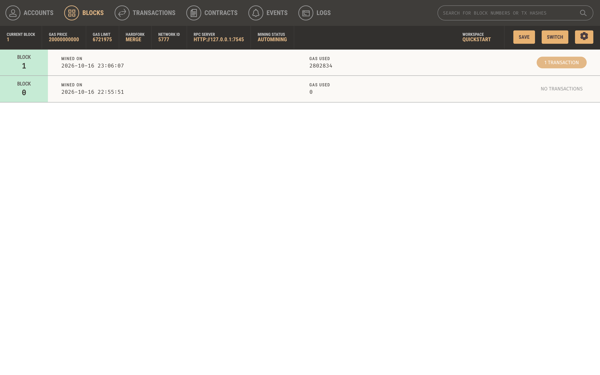 |
| MetaMask connection | 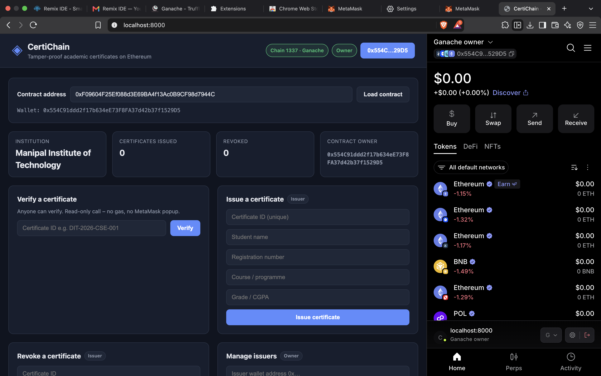 |
| MetaMask transaction request | 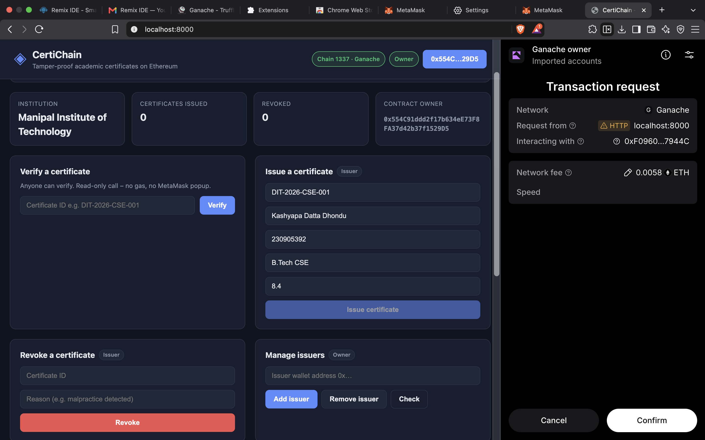 |
| Successful transaction | 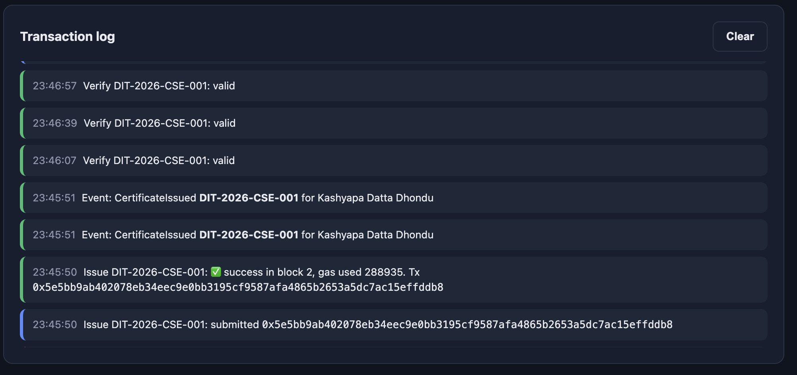 |
| Failed transaction | 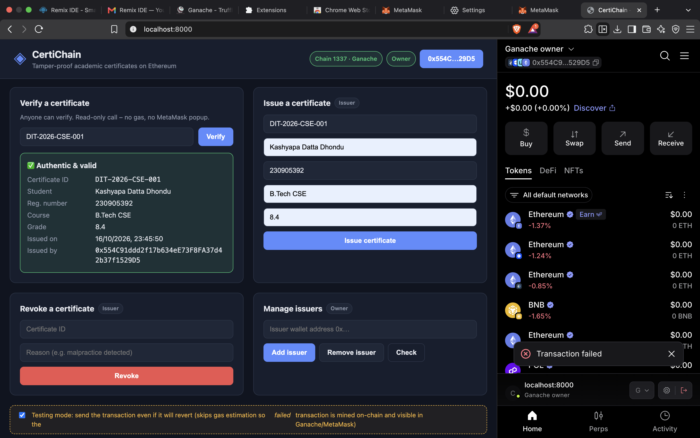 |
| Blockchain data in the UI | 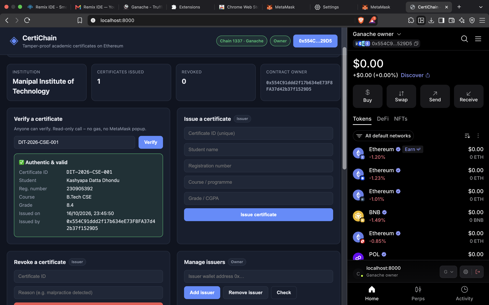 |
| Verify an ID that does not exist | 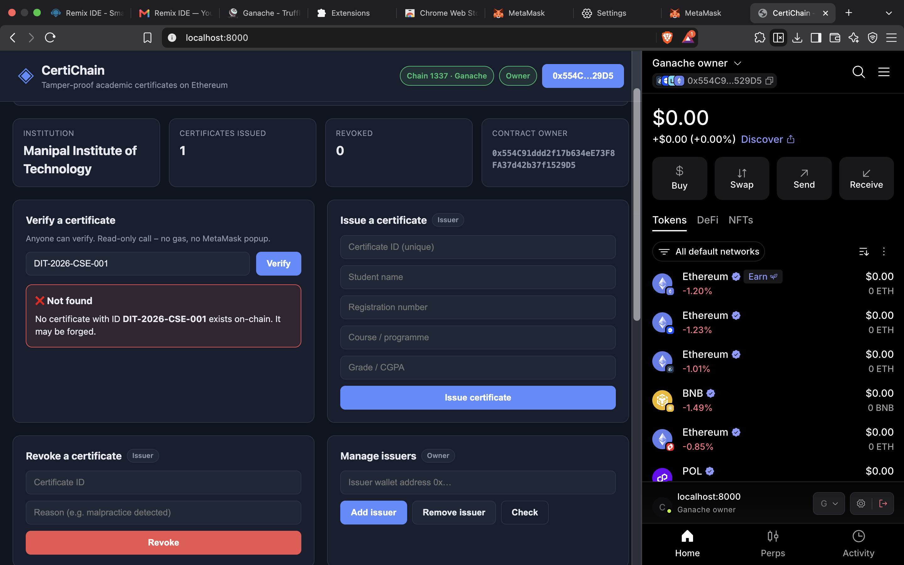 |
| Unit test results | 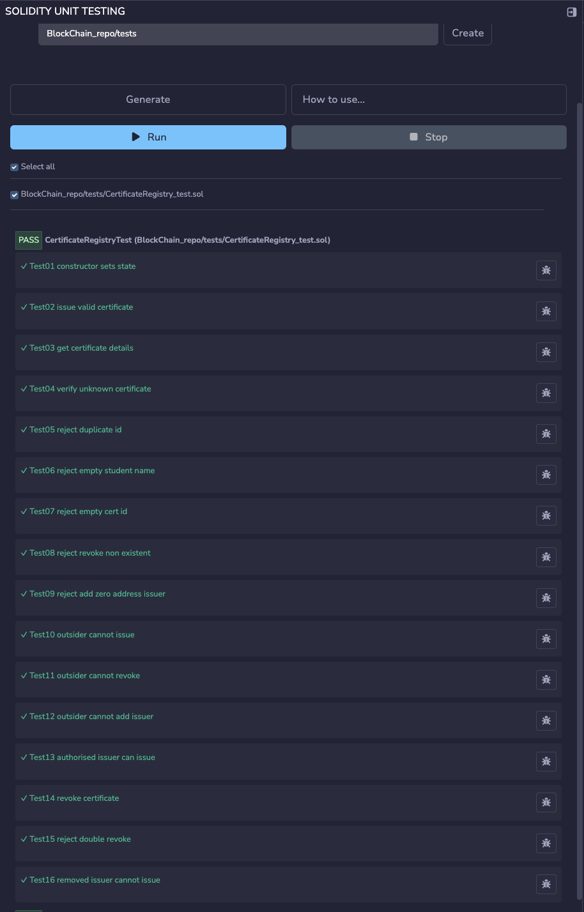 |
| Unauthorised attempt | 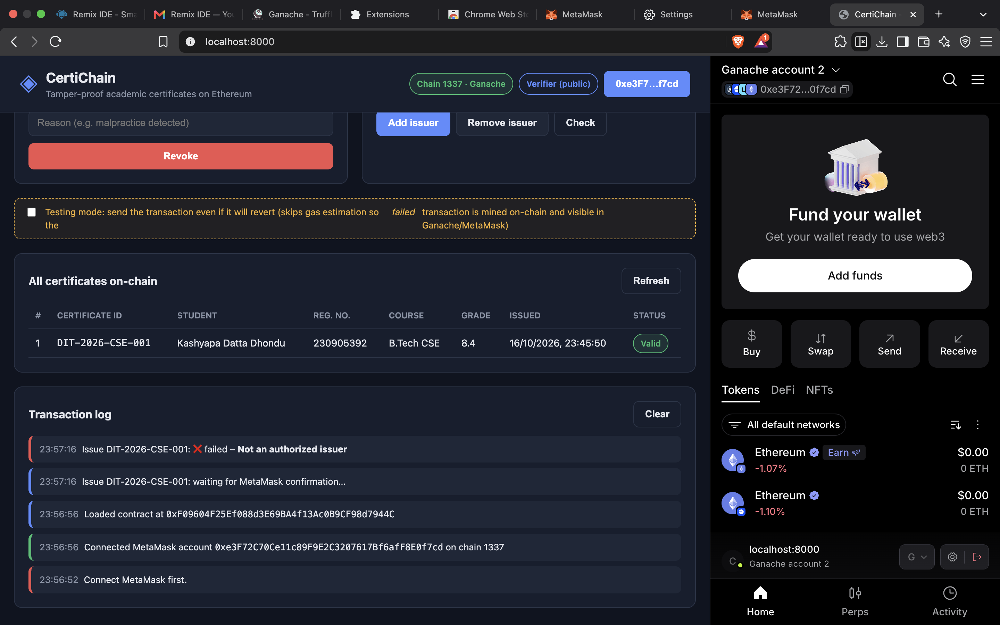 |

No private keys or seed phrases are stored in this repository.
